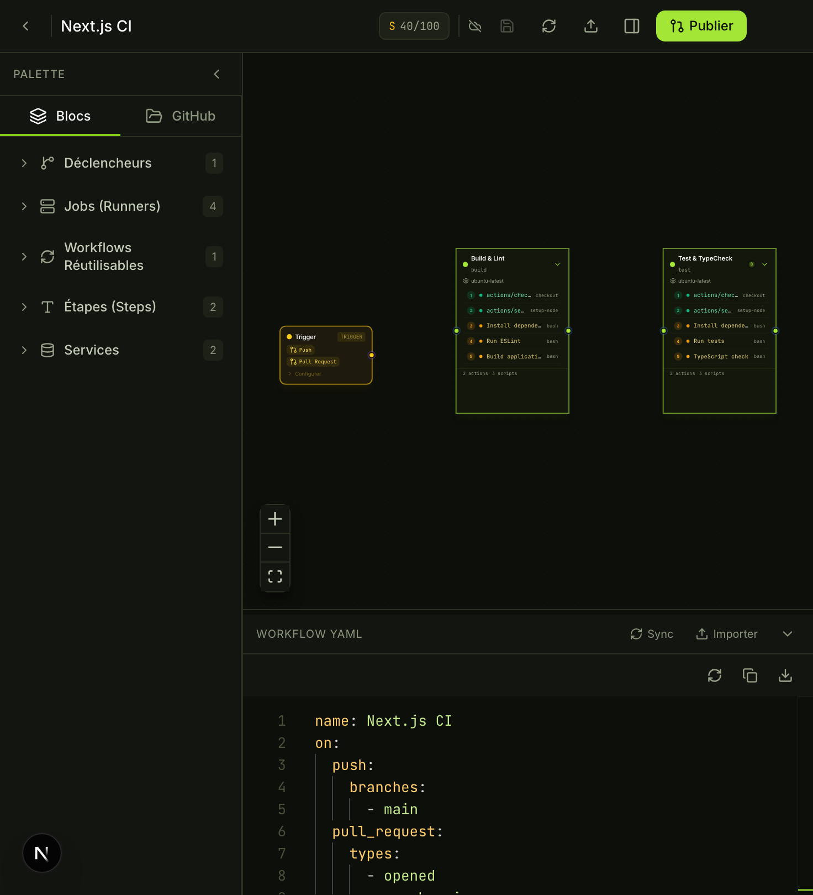
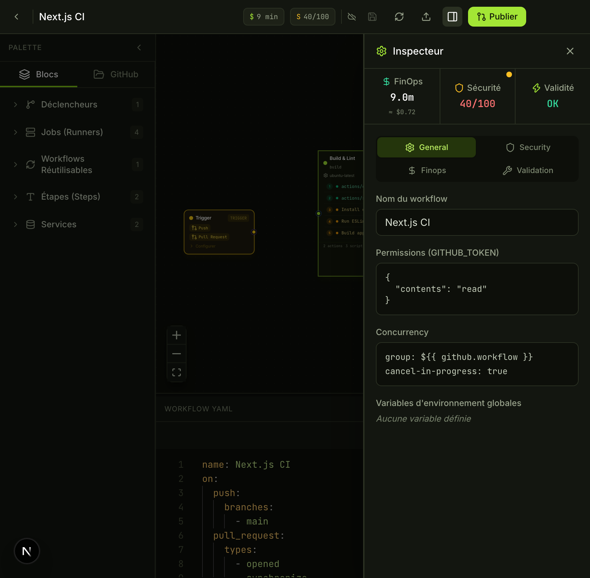
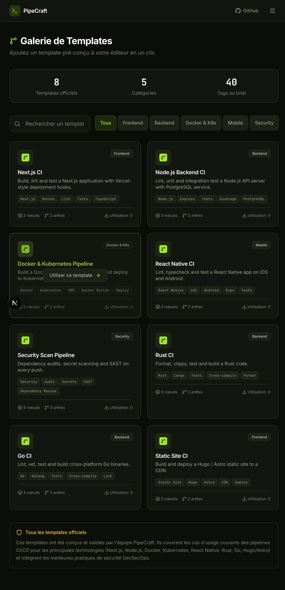

# PipeCraft

[](LICENSE)
[](https://github.com/lemonlimeacid/PipeCraft/releases/latest)
[](https://github.com/lemonlimeacid/PipeCraft/actions/workflows/release.yml)

**A visual CI/CD pipeline editor for GitHub Actions.** Build workflows on a canvas, get clean YAML out, and validate pipelines before they ever reach your repository.

Write pipelines by connecting nodes — triggers, jobs, steps, reusable workflows — instead of hand-editing YAML. PipeCraft keeps the graph and the YAML in sync in both directions, so you can start visually and finish in code (or the other way around).



## Download

Grab the latest desktop build from the [**Releases**](https://github.com/lemonlimeacid/PipeCraft/releases/latest) page:

| Platform | Asset |
| --- | --- |
| Windows (x64) | `PipeCraft-1.0.1-win-x64.exe` |
| macOS (Intel) | `PipeCraft-1.0.1-mac-x64.dmg` / `.zip` |
| macOS (Apple Silicon) | `PipeCraft-1.0.1-mac-arm64.dmg` / `.zip` |
| Linux (x64) | `PipeCraft-1.0.1-linux-x86_64.AppImage` |
| Linux (Flatpak) | `PipeCraft-1.0.1-x86_64.flatpak` |

The desktop builds are **not code-signed**:
- **macOS** — right-click the app → *Open*, or run `xattr -dr com.apple.quarantine /Applications/PipeCraft.app`.
- **Windows** — SmartScreen will warn about an unknown publisher; choose *More info → Run anyway*.
- **Linux AppImage** — `chmod +x PipeCraft-*.AppImage && ./PipeCraft-*.AppImage`.

## Features

- **Visual editor** — Design pipelines with connected nodes: triggers, jobs, steps and reusable workflows. No YAML required.
- **Two-way YAML sync** — Every canvas change produces clean GitHub Actions YAML; paste or import YAML and the graph updates instantly.
- **Validation & DevSecOps checks** — Catches script injection patterns, unpinned actions, excessive permissions and plaintext secrets before you push.
- **GitHub runner cost estimate** — Estimates GitHub Actions runner billing from runner type, estimated minutes and matrix expansion (Linux 1×, Windows 2×, macOS 10×).
- **AI assistant (`Cmd/Ctrl + K`)** — Describe the change you want in plain language and let it update the graph.
- **Local runs with `act`** — Generates the [nektos/act](https://github.com/nektos/act) command to test a workflow locally.
- **Templates & projects** — Start from built-in templates, save and reopen your own pipelines.

> **Cost estimates are GitHub's, not PipeCraft's.** The FinOps panel estimates what GitHub *would* bill for the runners a workflow uses. It is an approximation based on public runner pricing and multipliers. **PipeCraft itself is free** and never charges for usage.

## Screenshots

| Editor | Templates |
| --- | --- |
|  |  |

## Tech stack

- **App** — Next.js (App Router), React, TypeScript
- **Canvas** — [React Flow (`@xyflow/react`)](https://reactflow.dev/) with [dagre](https://github.com/dagrejs/dagre) auto-layout
- **Editor** — Monaco + `monaco-yaml`
- **State** — Zustand, Immer, Zundo (undo/redo)
- **Validation** — AJV + a GitHub Actions workflow JSON schema
- **Data & auth** — Prisma, NextAuth
- **Desktop** — Electron + electron-builder (NSIS, DMG/ZIP, AppImage) and a Flatpak manifest

## Development

### Prerequisites

- [Bun](https://bun.sh/) (recommended, a `bun.lock` is committed) or Node.js 20+
- A PostgreSQL database if you want projects/auth persistence

### Setup

```bash
bun install
bun run db:generate
bun run db:push
bun run dev
```

Create a `.env` file at the project root with the variables you need:

| Variable | Purpose |
| --- | --- |
| `DATABASE_URL` | PostgreSQL connection string (Prisma) |
| `AUTH_SECRET` | NextAuth session secret |
| `GITHUB_CLIENT_ID` / `GITHUB_CLIENT_SECRET` | GitHub OAuth app credentials (sign-in) |
| `ENCRYPTION_MASTER_KEY` | 32-byte hex key used to encrypt stored tokens |
| `GITHUB_PUBLIC_TOKEN` | Optional read-only token for public GitHub metadata |

The app runs on `http://localhost:3000`. `/editor/sandbox` opens a free, no-auth editor with a demo pipeline, so you can try the editor without configuring auth.

### Useful scripts

| Command | Description |
| --- | --- |
| `bun run dev` | Next.js dev server (Turbopack) |
| `bun run build` | Production build |
| `bun run start` | Serve the production build |
| `bun run db:generate` / `db:push` | Prisma client / schema sync |
| `bun run db:studio` | Prisma Studio |
| `bun run desktop:build` | Build the standalone server bundle for Electron |
| `bun run desktop:run` | Build and launch the desktop app |
| `bun run dist:win` / `dist:mac` / `dist:linux` | Package installers with electron-builder |

## Desktop packaging

The Electron shell (`electron/main.cjs`) starts the bundled Next.js standalone server on a local port and opens it in a native window. Packaging is configured in `electron-builder.yml`:

- **Windows** — NSIS installer (x64)
- **macOS** — DMG + ZIP (x64 and arm64)
- **Linux** — AppImage (x64) plus an unpacked directory used for the Flatpak

Flatpak is built from `dev.pipecraft.PipeCraft.yml`, which packages the `linux-unpacked` directory on top of `org.electronjs.Electron2.BaseApp` (25.08).

## Releases

Pushing a `v*` tag runs [`.github/workflows/release.yml`](.github/workflows/release.yml), which:

1. Builds the desktop server bundle on Windows, macOS and Linux.
2. Packages the installer/archives, the AppImage and the Flatpak bundle.
3. Publishes every artifact to a GitHub Release.

```bash
git tag v1.0.1
git push origin v1.0.1
```

## Project structure

```
src/app/            Next.js routes (landing, dashboard, editor, API)
src/components/     Canvas, nodes/edges, inspector forms, panels, modals
src/lib/            Graph ↔ YAML compiler, validation, security linting, FinOps
src/store/          Pipeline state (Zustand + undo/redo)
electron/           Electron main process
prisma/             Database schema
scripts/            Build helpers (desktop bundle preparation)
flatpak/            Desktop entry and launcher for the Flatpak build
```

## Notes

- PipeCraft is an independent project and is not affiliated with GitHub or Microsoft.
- Runner cost figures are estimates and can differ from what GitHub actually bills.
- The desktop binaries are unsigned; see the download notes above.

## License

Released under the [MIT License](LICENSE). You are free to use, modify and distribute PipeCraft, including commercially, provided the copyright notice and permission notice are included in copies or substantial portions of the software.
